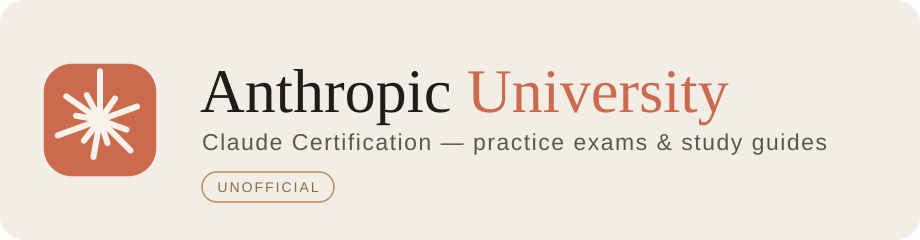
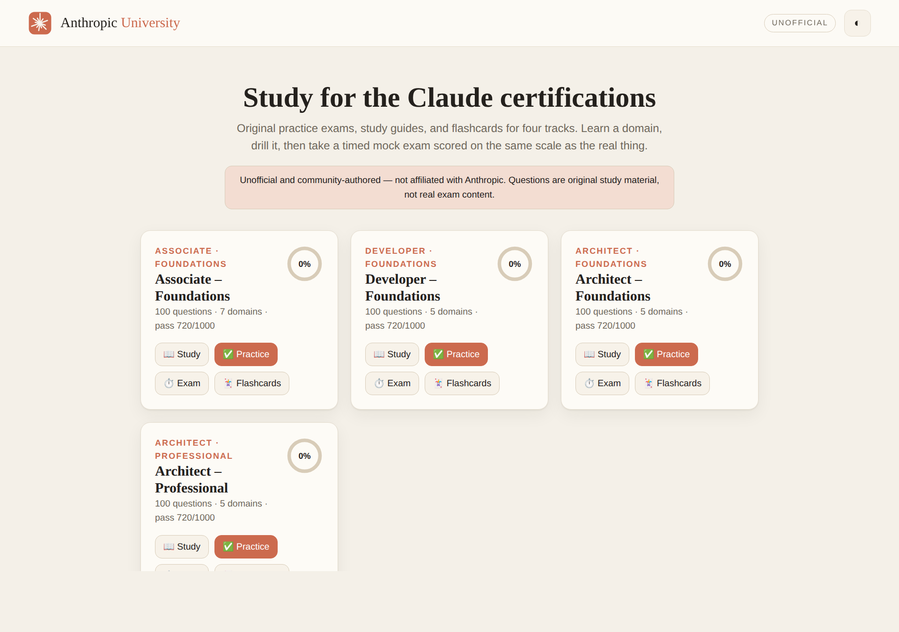
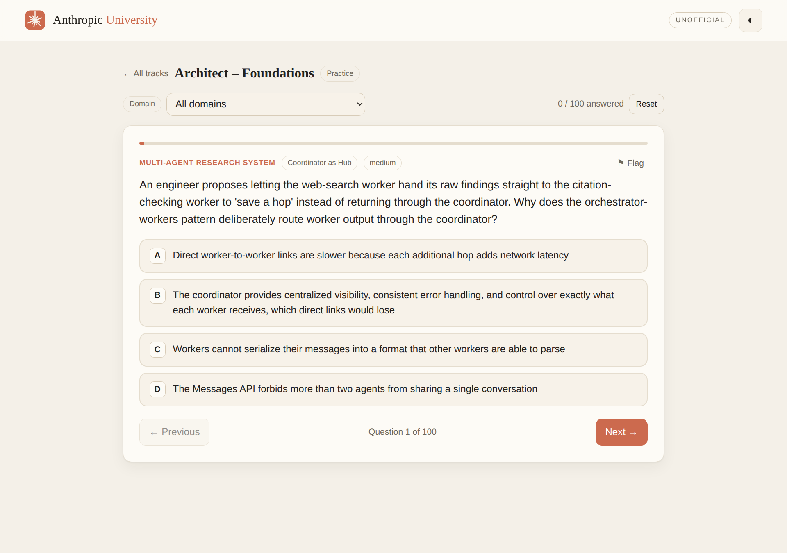
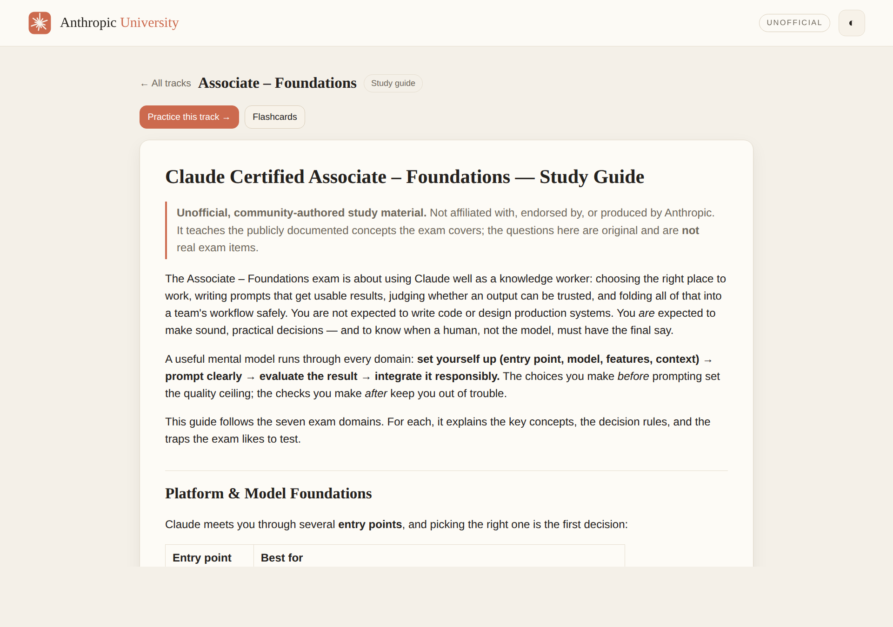
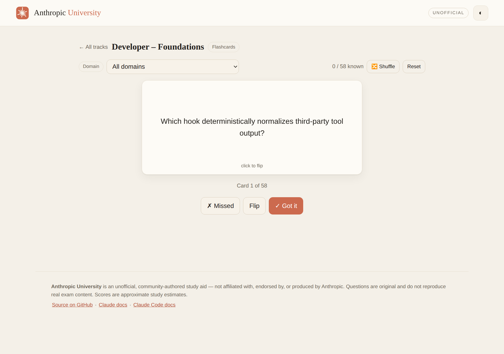

<p align="center">
  
</p>

<p align="center">
  <a href="https://github.com/patrickking67/anthropic-university/actions/workflows/validate.yml"></a>
  <a href="LICENSE"></a>
</p>

# Anthropic University

Unofficial practice exams, study guides and flashcards for Anthropic's four Claude certifications,
with a web app and Claude Code plugins to study with.

> [!IMPORTANT]
> **Unofficial and community-written.** Anthropic University is not affiliated with, endorsed by, or
> produced by Anthropic. Every question is original and written to teach publicly documented concepts.
> None of it is real exam content. The logo and artwork are original.

## The certifications

Anthropic describes four role-based certifications in
[its overview](https://claude.com/resources/articles/four-role-based-claude-certifications): Associate:
Foundations, Developer: Foundations, Architect: Foundations and Architect: Professional. Per that page,
exams are proctored through Pearson, require identity checks, award a Credly badge, and are open to
members of the Claude Partner Network. Prep courses are in the Anthropic Partner Academy.

The page does not publish a question count, time limit, scoring scale or pass mark. The app's scaled
score (100 to 1000, 720 to pass) follows what candidates report. Treat it as a rough guide.

Do not use AI help during a real exam and do not share real exam questions. Check the official exam
rules when you register.

## What's inside

Four tracks, each with 100 original questions, a study guide and a flashcard set:

| Track | Study guide | Practice exam | Flashcards |
| --- | --- | --- | --- |
| Claude Certified Associate: Foundations | [guide](content/associate-foundations/study-guide.md) | [100 questions](content/associate-foundations/practice-exam.md) | [cards](content/associate-foundations/flashcards.md) |
| Claude Certified Developer: Foundations | [guide](content/developer-foundations/study-guide.md) | [100 questions](content/developer-foundations/practice-exam.md) | [cards](content/developer-foundations/flashcards.md) |
| Claude Certified Architect: Foundations | [guide](content/architect-foundations/study-guide.md) | [100 questions](content/architect-foundations/practice-exam.md) | [cards](content/architect-foundations/flashcards.md) |
| Claude Certified Architect: Professional | [guide](content/architect-professional/study-guide.md) | [100 questions](content/architect-professional/practice-exam.md) | [cards](content/architect-professional/flashcards.md) |

Answer keys are grounded in the official docs at [platform.claude.com/docs](https://platform.claude.com/docs)
and [code.claude.com/docs](https://code.claude.com/docs).

## Web app

A static app in `docs/` with four modes:

- **Study**: read a track's guide.
- **Practice**: one question at a time with instant feedback, study-area tags, and filters for
  unanswered, missed and flagged questions. Keys: `A` to `D`, arrows, `F` to flag.
- **Exam**: a timed mock with an approximate scaled score, a per-domain breakdown, and review of misses,
  flags or every item.
- **Flashcards**: flip, shuffle, and mark cards known or unknown. Keys: `Space` to flip, `1` and `2` to grade.

Progress stays in your browser (`localStorage`). There is no live site yet: GitHub Pages is not enabled
for this repo. To run it locally:

```bash
node scripts/serve.mjs     # http://localhost:4106/
```

Opening `docs/index.html` directly from disk also works.

<p align="center">
  
  
</p>
<p align="center">
  
  
</p>

## Study inside Claude Code

Add the marketplace and install the plugins:

```text
/plugin marketplace add patrickking67/anthropic-university
/plugin install exam-coach@anthropic-university
/plugin install flashcard-drill@anthropic-university
```

Then:

```text
/exam-coach:quiz-me architect-foundations
/exam-coach:mock-exam developer-foundations
/exam-coach:explain-concept prompt caching
/flashcard-drill:flashcards associate-foundations
```

- **exam-coach**: adaptive quizzes, timed mock exams, concept explanations and answer grading.
- **flashcard-drill**: flashcard drilling in the terminal.
- **cert-author**: contributor tools to write and review questions (same workflow as `.claude/skills/`).

The repo also ships [`.mcp.json`](.mcp.json) with the official Claude Code Docs MCP server, so Claude can
look things up while you study or contribute.

## A study plan

1. Read the study guide for your track.
2. Practice by domain until you can explain why each answer is right.
3. Drill flashcards for the concepts that keep slipping.
4. Take a timed exam, review every miss, and revisit that domain.

## How it's built

`content/<track>/questions.json` and `flashcards.json` are the source of truth. A dependency-free Node
script validates them and generates the markdown exams, flashcard files, app data and plugin data.

```bash
node scripts/check.mjs           # everything CI runs
node scripts/build.mjs           # validate and regenerate
node scripts/build.mjs --check   # validate only
```

Node 20 or later. Nothing to install. See [AGENTS.md](AGENTS.md) for the layout, schema and rules.

## Deploy

[`pages.yml`](.github/workflows/pages.yml) publishes `docs/` to GitHub Pages on every push to `main`
once the repo owner turns Pages on (Settings, Pages, Source: GitHub Actions). Until then the deploy is
skipped. Merging to `main` also updates the plugins for everyone who added the marketplace.

## Contributing

Corrections and new questions are welcome. Read [CONTRIBUTING.md](CONTRIBUTING.md), keep content
original, and open a PR. Security issues: see [SECURITY.md](SECURITY.md).

## License

Code and tooling: [MIT](LICENSE). Study content is for personal exam preparation. "Claude" and
"Anthropic" are trademarks of Anthropic, used here only to describe what the material covers.
